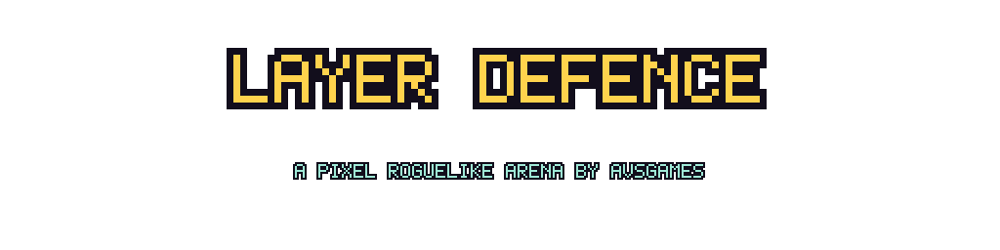

# Layer Defence

A compact pixel-art roguelike arena by **AvSGames**. Enemies rain from a shifting
portal, pots and treasure chests drop loot, and every 5th wave brings a boss.
Spend coins on upgrades between waves, then step into the green gate to summon
the next one.

Every sprite, sound effect, the bitmap font and the store art are **generated by
this repository's own tooling** (`Tools/artgen/`, Python + Pillow) — nothing is
downloaded, and the whole asset set is reproducible from source.



## Play

The game is playable in the browser (WebAssembly) and on Windows.

| Action | Key |
|---|---|
| Move | `A` / `D` |
| Jump (tap for a higher hop) | `Space` |
| Dash (invulnerable) | `Shift` / `J` |
| Drop through a platform | `S` |
| Aim | Mouse |
| Attack (hold to keep swinging) | Left mouse button |
| Shop between waves | `Tab` / `E` |
| Close the shop | `Esc` |
| Controls legend | `H` / `F1` |
| Demo bot (attract mode) | `F10` |

## Content

- **10 enemy types** — slimes that split, diving bats, bone-throwing skeletons,
  leaping spiders, imp archers, charging orcs, phasing ghosts, suicide bombers,
  teleporting dark mages, slam-shocking stone golems — plus elite variants.
- **3 bosses** every 5th wave: Slime King, Necromancer, Demon Lord, each with
  summons and a second phase.
- **7 weapons**: sword, twin dagger, war spear, war hammer, bone scythe, hunter
  bow, arcane staff.
- **22 upgrades** with levels, a rerollable shop and coins that magnetise to you.
- **Procedural arena**: platforms slide in and out between rounds and the portal
  reopens on the opposite side of the arena.

## Building

Requires Godot 4.7.1 and Python 3.11+ with Pillow (only for regenerating assets).

```bash
# regenerate every sprite, sound effect and the bitmap font
python Tools/artgen/main.py

# import assets (always required after regenerating art)
godot --headless --import --path .

# web build for itch.io -> build/web/index.html (main file must stay index.html)
godot --headless --path . --export-release "Web" "build/web/index.html"

# windows build
godot --headless --path . --export-release "Windows Desktop" "build/windows/LayerDefence.exe"
```

The zip uploaded to itch.io must contain the contents of `build/web/` **at the
root** (`index.html`, `index.js`, `index.wasm`, `index.pck`, the two worklets
and the icons). See `docs/itch-io.html` for the full publishing checklist.

## Documentation

| Document | Content |
|---|---|
| `docs/game-guide.html` | how the game works + technique deep-dives (camera shake, juice, procedural art, wave budget, AI archetypes, shop math...) |
| `docs/itch-io.html` | everything needed to fill in the itch.io page (texts, tags, embed options, troubleshooting) |

## License

- **Code** (`Scripts/`, `Scenes/`, `Resources/`, `Tools/`): MIT — see [`LICENSE`](LICENSE).
- **Assets** (sprites, sounds, font, branding, store art): CC BY 4.0 — see
  [`LICENSE-ASSETS.md`](LICENSE-ASSETS.md).
- **Third-party** (Godot Engine and its dependencies): see [`THIRD-PARTY.md`](THIRD-PARTY.md).

`Copyright (c) 2026 AvSGames`
